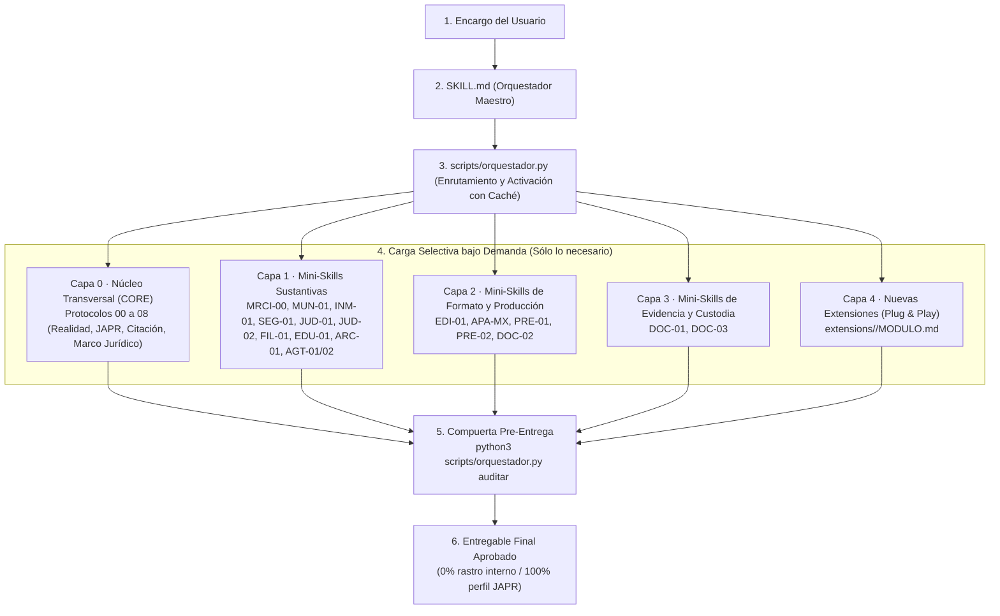

# RFC / Propuesta Técnica: Arquitectura de Orquestador Maestro y Mini-Skills (`feature/orquestador`)

> **Repositorio:** `Albertcor11/multisistemas-mrci-5`  
> **Rama de trabajo:** `feature/orquestador`  
> **Versión propuesta:** `5.1.0-orquestador`  
> **Fecha:** 27 de octubre de 2026  
> **Objetivo de este documento:** Explicar al equipo de desarrollo qué se construyó, cómo funciona la nueva arquitectura de carga selectiva (*Progressive Disclosure*), qué archivos se actualizaron y cómo agregar nuevas funciones sin alterar los binarios base, con el fin de recabar retroalimentación antes de hacer *merge* a `main`.

---

## 1. Diagnóstico: ¿Qué problema resolvemos?

En la versión de `main`, `multisistemas-mrci-5` integra **17 módulos** (16 módulos base empaquetados en `assets/corpus/parte-*.bin` con 908 archivos + la extensión sellada `PRE-02` con 128 archivos). Al analizar el comportamiento de la skill y su grafo de conocimiento (376 nodos, 633 relaciones y 17 comunidades), detectamos **4 cuellos de botella**:

| Problema en `main` | Impacto en el Agente IA y en el Equipo | Solución en `feature/orquestador` |
|---|---|---|
| **1. Sobrecarga de contexto en `SKILL.md`** | `SKILL.md` mezclaba el enrutador general con instrucciones operativas extensas de `PRE-02` (PowerPoint) y `APA México`. Aunque el usuario pidiera un dictamen municipal (`MUN-01`) o de seguros (`SEG-01`), la IA leía reglas de diapositivas y tesis. | **`SKILL.md` como Orquestador Puro:** Se movieron las reglas específicas de formato a fichas modulares (`miniskill-pre02.md` y `miniskill-apa-mexico.md`) que sólo se cargan cuando el encargo lo requiere. |
| **2. Descompresión repetitiva sin caché** | `abrir_corpus.py` creaba un directorio temporal nuevo (`tempfile.mkdtemp`) en cada ejecución, reconstruyendo el ZIP desde las 12 partes `.bin`. Además, `PRE-02` se invocaba con otro script separado. | **Caché persistente verificada por SHA-256:** `scripts/orquestador.py` extrae bajo demanda sólo las mini-skills solicitadas en una caché determinista (`/tmp/mrci5-cache-<hash>`) verificando cada archivo por huella. |
| **3. Rigidez para crear nuevas funciones** | Agregar una capacidad nueva exigía extraer todo el corpus, editarlo, cuidar rutas NFD/NFC y correr `reempaquetar_corpus.py` regenerando todos los `.bin`. | **Sistema Plug & Play (`crear-miniskill`):** Ahora se pueden crear nuevas mini-skills en `extensions/<CODIGO>/` con un solo comando y registrarlas en el catálogo sin tocar los `.bin`. |
| **4. Verificación manual de anonimato** | La regla de oro del sistema prohíbe mencionar en los entregables términos internos (`MRCI`, `ANJU`, `EDI-01`, `PENO-01`, etc.), pero dependía de búsquedas manuales antes de entregar. | **Compuerta automática (`orquestador.py auditar`):** Escanea automáticamente archivos `.docx`, `.pptx`, `.md` y `.txt` contra marcas internas y las 42 reglas de `LEXICO_CONTROL_IA.csv`. |

---

## 2. ¿Cómo funciona la nueva arquitectura?

Seguimos manteniendo **una sola skill instalable** (`multisistemas-mrci-5`) para no complicar la instalación del usuario final, pero internamente opera como un **Orquestador Hub & Spoke** organizado en **4 capas**:



### El flujo en 4 pasos cuando la IA recibe un encargo:

1. **Recepción y Clasificación (`enrutar`):** El agente lee `SKILL.md` (ligero y directo) e identifica qué mini-skill lleva la **rectoría sustantiva** (ej. `SEG-01`), cuál lleva el **formato** (ej. `PRE-02`) y cuál la **evidencia** (`DOC-03`).
2. **Activación Selectiva (`activar`):** Ejecuta `python3 scripts/orquestador.py activar SEG-01 PRE-02`. El motor verifica la caché SHA-256, prepara el núcleo transversal (`CORE`) y devuelve un JSON con las rutas exactas que la IA debe leer.
3. **Ejecución Aislada:** La IA lee únicamente el `MODULO.md` y las referencias de las mini-skills activadas, sin contaminar su ventana de contexto con los otros 15 módulos.
4. **Auditoría de Salida (`auditar`):** Antes de entregar el documento (`.docx`, `.pptx`, `.md`), ejecuta `python3 scripts/orquestador.py auditar <archivo>`. Si detecta siglas internas (`MRCI`, `PENO-01`, `EDI-01`) o frases vetadas de IA (`claro, aquí tienes`, `prueba de espejo`, etc.), devuelve `ENTREGA_BLOQUEADA` indicando exactamente qué corregir.

---

## 3. Mapa de archivos construidos y actualizados

### Archivos Nuevos Creados

| Archivo | Propósito técnico |
|---|---|
| `scripts/orquestador.py` | **Motor CLI unificado** en Python 3.10+ (sin dependencias externas). Incluye los subcomandos `listar`, `enrutar`, `activar`, `crear-miniskill`, `auditar` y `verificar`. |
| `references/catalogo-orquestador.json` | **Catálogo declarativo** de las 18 mini-skills actuales (16 del corpus + `PRE-02` + `APA-MX`), sus capas, rutas de entrada, apoyos sugeridos y palabras clave de enrutamiento. |
| `references/miniskill-pre02.md` | **Ficha modular de `PRE-02`** extraída de `SKILL.md`. Contiene las reglas de edición de PowerPoint, fidelidad literal Word–PPTX, preservación quirúrgica y uso de `PENO-01`. |
| `references/miniskill-apa-mexico.md` | **Ficha modular de `APA-MX`** extraída de `SKILL.md`. Contiene las reglas de citación APA México 4.ª ed., transcripción OCR, regla Bloom-espejo y las 3 auditorías académicas obligatorias. |

### Archivos Actualizados

| Archivo | Qué se actualizó |
|---|---|
| `SKILL.md` | Se reestructuró como **Orquestador Maestro**. Conserva íntegras todas las reglas de negocio, tabla de rectoría, arbitraje SOL/DALILA y calidad de entrega, pero delega los bloques específicos de PowerPoint y APA a sus fichas modulares e integra los comandos de `scripts/orquestador.py`. |
| `AGENTS.md` | Se documentó la nueva estructura de archivos, el flujo para crear nuevas mini-skills sin tocar los `.bin` y se registró el cambio en el historial. |

### Archivos Intactos (100% Retrocompatibilidad)

* `assets/corpus/parte-01.bin` a `parte-12.bin` y `references/inventario.json` **no fueron alterados**.
* `assets/PRE-02/`, `extensions/PRE-02/` y `references/inventario-PRE-02.json` **no fueron alterados**.
* `scripts/abrir_corpus.py`, `scripts/reempaquetar_corpus.py` y `scripts/preparar_PRE02.py` **siguen funcionando exactamente igual**.

---

## 4. Guía de comandos del nuevo `scripts/orquestador.py`

### 4.1. Listar todas las mini-skills disponibles
```bash
python3 scripts/orquestador.py listar
# O filtrando por capa:
python3 scripts/orquestador.py listar --capa formato
```

### 4.2. Enrutar automáticamente un encargo en lenguaje natural
```bash
python3 scripts/orquestador.py enrutar "Necesito hacer una presentación ejecutiva en PowerPoint sobre una reclamación de póliza de seguros"
```
**Respuesta del motor:**
```json
{
  "encargo": "Necesito hacer una presentación ejecutiva en PowerPoint sobre una reclamación de póliza de seguros",
  "miniskills_recomendadas": ["SEG-01", "PRE-01", "PRE-02"],
  "advertencias_orquestacion": [
    "Producción de presentaciones: conservar al módulo especialista como responsable del fondo; no desplazar la especialidad sustantiva por el formato."
  ],
  "comando_activacion": "python3 scripts/orquestador.py activar SEG-01 PRE-01 PRE-02"
}
```

### 4.3. Activar selectivamente mini-skills (con caché SHA-256)
```bash
python3 scripts/orquestador.py activar SEG-01 PRE-02
# Si se requieren las 128 plantillas/muestras visuales de PRE-02:
python3 scripts/orquestador.py activar SEG-01 PRE-02 --incluir-recursos-pre02
```
Devuelve inmediatamente las rutas absolutas del `nucleo_transversal` (`00` a `08`) y de cada mini-skill activada en la caché verificada.

### 4.4. Crear una nueva función / mini-skill (Plug & Play)
Cualquier desarrollador puede agregar una nueva mini-skill sin desempaquetar ni regenerar los `.bin`:
```bash
python3 scripts/orquestador.py crear-miniskill \
  --codigo FIS-01 \
  --nombre defensa-fiscal-mrci \
  --titulo "Defensa Fiscal y Litigio Tributario" \
  --descripcion "Análisis de créditos fiscales, recurso de revocación y juicio contencioso administrativo." \
  --capa sustantivo \
  --palabras-clave "crédito fiscal,sat,revocación,nulidad,tributario" \
  --apoyos "DOC-03,JUD-02"
```
Esto crea `extensions/FIS-01/MODULO.md`, `extensions/FIS-01/references/` y `extensions/FIS-01/scripts/`, y la registra en `references/catalogo-orquestador.json`.

### 4.5. Auditar un entregable antes de darlo al usuario
```bash
python3 scripts/orquestador.py auditar /ruta/al/Dictamen_Final.docx
```
Inspecciona el texto interno de archivos `.docx`, `.pptx`, `.md` o `.txt` y bloquea la entrega (`ENTREGA_BLOQUEADA`) si encuentra cualquier sigla interna (`MRCI`, `EDI-01`, `PENO-01`, `DALILA`, etc.) o muletillas vetadas del léxico JAPR (`LEX-001` a `LEX-042`).

### 4.6. Verificar la integridad global del sistema
```bash
python3 scripts/orquestador.py verificar
```

---

## 5. Preguntas para Retroalimentación del Equipo (Antes de Merge a `main`)

Para validar que esta implementación cumple exactamente con lo que buscamos antes de abrir el Pull Request definitivo hacia `main`, solicitamos al equipo revisar y comentar sobre los siguientes puntos:

1. **Granularidad de las Mini-Skills:**
   - Hoy tenemos **18 mini-skills** registradas (los 16 módulos base + `PRE-02` + `APA-MX`).
   - *¿Consideran conveniente subdividir también `EDI-01` (que tiene 202 archivos y 10 motores) en mini-skills más específicas dentro del catálogo (por ejemplo: `EDI-TESIS` para protocolos/tesis y `EDI-WORD` para formato Word 1.6.0), o prefieren mantener `EDI-01` + `APA-MX` como están ahora?*
2. **Flujo de creación de nuevas funciones (`extensions/` vs `.bin`):**
   - Con `crear-miniskill`, las nuevas funciones viven directamente en `extensions/<CODIGO>/` en texto plano (fáciles de versionar en Git y revisar en PRs) sin tocar `assets/corpus/*.bin`.
   - *¿Están de acuerdo en que las nuevas mini-skills vivan en `extensions/` durante su desarrollo y sólo se empaqueten en `.bin` cuando se quiera sellar una versión mayor?*
3. **Compuerta de Auditoría (`orquestador.py auditar`):**
   - *¿Hay algún término adicional o regla de formato que quieran que agreguemos al escáner automático de `.docx` y `.pptx`?*
